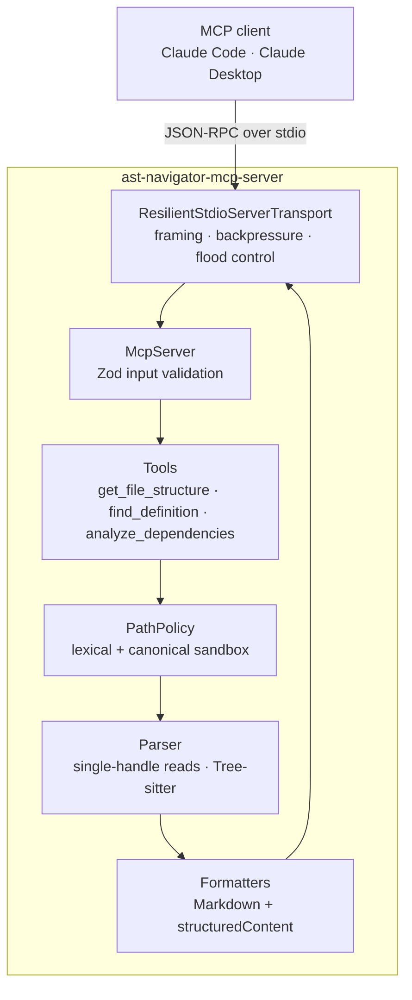

```text
        o
       / \
      o   o          A S T   N A V I G A T O R   M C P
     / \   \         =================================
    o   o   o        syntax-tree navigation for LLM agents
```

[](https://www.typescriptlang.org/)
[](https://nodejs.org/)
[](LICENSE)
[](#testing)

An [MCP](https://modelcontextprotocol.io) server that lets LLM agents navigate JavaScript and TypeScript repositories **through their syntax tree** - file outlines, symbol definitions and dependency graphs - instead of reading files end to end.

It is built for inputs it cannot trust. Filesystem access is sandboxed to the roots you choose, and the sandbox does not even leak *which* files exist outside it. The stdio transport stays within bounded memory when a client floods it with malformed JSON.

- **Cheaper context.** A compact outline costs a fraction of the tokens of the file it describes, with line ranges so the agent reads only what it needs.
- **Precise answers.** Matching runs on parsed declarations, not on text, so call sites, comments and strings never produce false hits.
- **Safe by construction.** Read-only tools, strict Zod contracts, a canonical-path sandbox, single-handle file reads and a transport with backpressure.

---

## Contents

- [Features](#features)
- [Architecture](#architecture)
- [Security & Resilience](#security--resilience)
- [Installation & Usage](#installation--usage)
- [Development](#development)
- [Limitations](#limitations)
- [License](#license)

---

## Features

### Tree-sitter at the core

Every answer comes from a real parse, not from regular expressions:

- **Native Tree-sitter 0.25** with the JavaScript (including JSX), TypeScript and TSX grammars. Supported files: `.js .mjs .cjs .jsx .ts .mts .cts .tsx`, including `.d.ts`.
- **Error tolerant.** Tree-sitter still builds a tree for code that does not compile. Syntax errors are reported with their line numbers, and the rest of the file is still analysed.
- **Lazy parsers.** One parser per language is created on first use and then reused; parsing is synchronous, so a shared instance is never used concurrently.
- **No toolchain required.** The grammars ship prebuilt binaries for Windows, macOS and Linux on x64 and arm64.
- **Two output formats.** Every tool returns a token-cheap Markdown view *and* typed `structuredContent` validated against a published `outputSchema`.

### Three read-only tools

| Tool | Question it answers | Required input |
|---|---|---|
| [`get_file_structure`](#get_file_structure) | *What is in this file?* | `filePath` |
| [`find_definition`](#find_definition) | *Where is this symbol declared?* | `name` |
| [`analyze_dependencies`](#analyze_dependencies) | *Which local files does this file load?* | `filePath` |

A typical agent loop: `find_definition` → `get_file_structure` on the hit → `analyze_dependencies` to follow the graph → read only the relevant lines.

#### `get_file_structure`

Outlines one file:

- **Imports:** ESM, CommonJS `require` and re-exports.
- **Classes:** properties and methods, with visibility, `static`, `async`, `abstract`, getters and setters.
- **Top-level functions:** declarations, arrow functions, function expressions and CommonJS exports.
- **TypeScript types:** interfaces, type aliases and enums.

Every entry carries 1-based line ranges, and signatures appear exactly as written.

| Parameter | Type | Default |
|---|---|---|
| `filePath` | string | - |
| `responseFormat` | `"markdown"` \| `"json"` | `"markdown"` |

```text
# /repo/src/services/UserService.ts
typescript | 42 lines | 3 imports | 1 class | 1 function | 1 type

## Imports
- L1 import 'node:crypto': { randomUUID }
- L2 import type '../models/user.js': { CreateUserInput, User }
- L3 import '../db/Repository.js': { Repository }

## Classes
- L10-36 export class UserService extends Repository<User> implements Disposable
  - properties: private readonly cache; static instances
  - L14-17 constructor(private readonly options: UserServiceOptions)
  - L19-23 async create(input: CreateUserInput): Promise<User>
  - L25-27 findById(id: string): User | undefined
  - L29-31 get size(): number
  - L33-35 [Symbol.dispose](): void

## Functions
- L38-42 export function createUserService(options: UserServiceOptions): UserService

## Types
- L5-7 export interface UserServiceOptions
```

#### `find_definition`

Finds where classes, functions, methods, interfaces, type aliases and enums are **declared**, recursively under a directory. It also accepts qualified names such as `UserService.create`.

| Parameter | Type | Default |
|---|---|---|
| `name` | string | - |
| `directory` | string | first allowed root |
| `matchMode` | `"exact"` \| `"prefix"` \| `"contains"` | `"exact"` |
| `caseSensitive` | boolean | `true` |
| `kinds` | `class`, `function`, `method`, `interface`, `type_alias`, `enum` | all |
| `limit` / `offset` | pagination, `limit` from 1 to 200 | `50` / `0` |
| `responseFormat` | `"markdown"` \| `"json"` | `"markdown"` |

Results are ranked by relevance (exact match first), then by path and line.

- **Text pre-filter:** a file is parsed only if it contains the searched name, so most files are never parsed at all.
- **Bounded reads:** at most 16 files are read concurrently.
- **Skipped while scanning:** dependency and build directories (`node_modules`, `dist`, `build`, `out`, `coverage`, `vendor`…), dot-directories, symlinks and minified bundles.

```text
# Definitions of 'create' (prefix) in /repo
Showing 1-4 of 4 | 7 files scanned, 4 files parsed

- [method] Repository.create(input: unknown): Promise<T>
  /repo/src/db/Repository.ts:L4 (exported)
- [method] UserService.create(input: CreateUserInput): Promise<User>
  /repo/src/services/UserService.ts:L19-23 (exported)
- [method] Calculator.create()
  /repo/src/utils/math.js:L14-16 (exported)
- [function] createUserService(options: UserServiceOptions): UserService
  /repo/src/services/UserService.ts:L38-42 (exported)
```

#### `analyze_dependencies`

Maps one file to the **local files it depends on**. Packages from `node_modules`, `node:` built-ins and path aliases are counted but not listed.

**Detection walks the whole tree**, not just the top level, because a `require` inside a function or a lazy `import()` loads a module all the same. It recognises:

- ES imports, including side-effect imports and `import type`;
- re-exports (`export ... from`);
- `require()`, including TypeScript's `import x = require()`;
- dynamic `import()`.

**Resolution mirrors TypeScript and Node.js** for local specifiers:

1. **The exact file.**
2. **The TypeScript source behind a `.js` specifier** (NodeNext style): `./util.js` → `util.ts`, `.mjs` → `.mts`, `.cjs` → `.cts`, `.jsx` → `.tsx`.
3. **Extension probing:** `.ts .tsx .d.ts .mts .cts .js .jsx .mjs .cjs .json`.
4. **Directory index files:** `./lib` → `lib/index.ts`.

The probing order depends on the importer. A TypeScript file prefers the `.ts` source over a compiled `.js` sibling; a JavaScript file prefers what Node.js would actually load. Bundler query suffixes (`./icon.svg?raw`) and `file:` URLs are also handled.

Several spellings of the same import (`./util` and `./util.js`) are merged into one entry. A file counts as type-only only if *every* reference to it is type-only.

| Parameter | Type | Default |
|---|---|---|
| `filePath` | string | - |
| `includeTypeOnly` | boolean: include `import type` / `export type ... from` | `true` |
| `responseFormat` | `"markdown"` \| `"json"` | `"markdown"` |

A JavaScript barrel file whose `.js` specifiers point at TypeScript sources, one of which is missing:

```text
# Dependencies of /repo/src/index.mjs
javascript | 2 internal dependencies | 1 unresolved | 0 external specifiers ignored

## Internal
- /repo/src/services/UserService.ts
  "./services/UserService.js" [re-export] L1
- /repo/src/models/user.ts
  "./models/user.js" [re-export] L2

## Unresolved
- "./polyfills.js": not_found [import] L3
```

Unresolved specifiers carry a reason: `not_found`, `invalid`, or `outside_roots`, which never reveals where the specifier points. The JSON output also counts the `require()` and `import()` calls whose argument is computed, since those cannot be followed statically.

---

## Architecture



```text
src/
├── index.ts                          Entry point: process guards + startup
├── constants.ts                      Every operational limit, in one auditable place
├── errors.ts                         AstNavigatorError (code + hint) and type guards
├── server/
│   ├── AstNavigatorServer.ts         Composition root: McpServer, tools, lifecycle
│   ├── ResilientStdioServerTransport.ts  Hardened stdio transport (bounded memory)
│   ├── config.ts                     CLI (allowed roots, --help, --version), validated with Zod
│   ├── logger.ts                     Structured stderr-only logger; console redirected
│   └── processGuards.ts              uncaughtException, unhandledRejection, EPIPE, signals
├── parser/
│   ├── index.ts                      Public API: extract_file_structure, extract_module_references
│   ├── model.ts                      Data contract: Zod schemas → DeepReadonly types
│   ├── languages.ts                  Extension → Tree-sitter grammar registry
│   ├── treeSitterParser.ts           Lazy per-language Parser instances
│   ├── fileReader.ts                 Single-handle reads, O_NOFOLLOW, typed fs errors
│   ├── structureExtractor.ts         Syntax tree → file outline
│   ├── definitions.ts                Outline → flat list of definitions
│   └── dependencies.ts               Syntax tree → module references (whole-tree walk)
└── tools/
    ├── index.ts                      registerTools()
    ├── schemas.ts                    Zod input/output contracts + z.infer types
    ├── pathPolicy.ts                 The sandbox: the only authority on paths
    ├── getFileStructure.ts           Tool: get_file_structure
    ├── findDefinition.ts             Tool: find_definition (search, ranking, pagination)
    ├── analyzeDependencies.ts        Tool: analyze_dependencies
    ├── dependencyResolver.ts         Node/TypeScript-style resolution through PathPolicy
    ├── directoryWalker.ts            Deterministic traversal that never follows links
    ├── formatters.ts                 Markdown renderers
    ├── responses.ts                  Uniform results, character limit, error mapping
    └── context.ts                    Dependencies injected into every tool
```

**Design principles**

- **stdout carries JSON-RPC and nothing else.** Every log line goes to stderr. The global `console` is also replaced with a stderr-bound one, so a stray `console.log` (ours or a dependency's) cannot corrupt the protocol stream.
- **Zod is the single source of truth.** Inputs are `z.strictObject`s (unknown fields are rejected), handlers are typed with `z.infer`, and output schemas are published as `outputSchema`. The CLI arguments and the log-level variable are validated too.
- **Actionable errors.** Expected failures come back as `isError` results that read `Error [CODE]: … Hint: …`. Unexpected ones are logged with their stack trace and reported generically. Either way, the session survives.
- **Stateless and read-only.** Every call re-reads the disk; no cache can go stale and no state can be corrupted.
- **Every limit lives in `constants.ts`.**

---

## Security & Resilience

**Threat model.** The server has two untrusted inputs:

- **Tool arguments**, chosen by a model that may have been prompt-injected by the very repository it is reading.
- **The raw byte stream on stdin.**

The guarantees: a sandboxed server never reads, lists or *reveals the existence of* anything outside its allowed roots, and no input makes its memory grow without bound.

### 1. Path traversal, without existence oracles

Blocking `../../../etc/passwd` is the easy part. The harder part is not leaking information through **how** a request is rejected. If a missing file outside the sandbox answers `FILE_NOT_FOUND` while an existing one answers `PATH_OUTSIDE_ROOTS`, the error code becomes a filesystem scanner. The defence is layered:

1. **Shape validation (Zod).** Control characters (including NUL) and Windows device-namespace prefixes (`\\?\`, `\\.\`) are rejected, since those prefixes bypass Win32 path normalisation. Traversal is deliberately *not* decided here: the schema cannot know the roots.
2. **`PathPolicy` is the only authority.** A path must be inside a root *canonically* (after `realpath`), so a symlink or NTFS junction inside a root cannot lead out of it. A root that is itself reached through a link (`/tmp` → `/private/tmp` on macOS) keeps working.
3. **Uniform answers outside the sandbox.** A path that is not lexically inside a root is either served, because it resolves canonically inside one, or rejected with `PATH_OUTSIDE_ROOTS`. It never gets `FILE_NOT_FOUND` or `PERMISSION_DENIED`, whether or not it exists.
4. **No probing through links.** When an in-root path cannot be resolved, `PathPolicy` canonicalises its deepest *existing* ancestor. If that ancestor lies outside the roots, the answer is `PATH_OUTSIDE_ROOTS`, so a link pointing out of the sandbox cannot be used to map its target.
5. **Defence in depth.** `PathPolicy` re-checks its own input (`INVALID_PATH`) instead of trusting callers. The directory walker never follows links. The dependency resolver routes *every* candidate path through `PathPolicy` before `stat`, and stops at the first candidate outside the roots.

| Probe against a sandboxed server | Naive `realpath` check | AST Navigator |
|---|---|---|
| Outside the root, file exists | `PATH_OUTSIDE_ROOTS` | `PATH_OUTSIDE_ROOTS` |
| Outside the root, file missing | `FILE_NOT_FOUND` ⚠️ | `PATH_OUTSIDE_ROOTS` |
| Through an in-root link that points out, file missing | `FILE_NOT_FOUND` ⚠️ | `PATH_OUTSIDE_ROOTS` |
| Inside the root, file missing | `FILE_NOT_FOUND` | `FILE_NOT_FOUND`: precise diagnostics where they are safe |

### 2. TOCTOU-resistant reads

- **One handle per read.** Files are opened once; the type and size checks then run on that handle (`fstat`) and the content is read from the same handle. There is no `stat(path)` followed by `readFile(path)`, so the path cannot be re-pointed between the check and the read.
- **`O_NOFOLLOW` when sandboxed.** A sandboxed path is already canonical, so a symlink appearing at its last component can only be a swap made after validation. The open refuses it.
- **Size re-checked after reading.** The 2 MiB limit is enforced again on the bytes actually decoded, so a file that grows mid-read is rejected rather than silently exceeding the limit.

The window between `realpath` and `open` is *narrowed*, not eliminated: Node.js exposes no `openat2(RESOLVE_BENEATH)`. See [Limitations](#limitations).

### 3. A stdio transport that cannot be flooded

The SDK's `StdioServerTransport` closes the connection when a message is too large, which ends the session. `ResilientStdioServerTransport` speaks the same wire format (newline-delimited JSON-RPC 2.0) but rejects bad frames and keeps serving:

| Input | Response |
|---|---|
| Invalid JSON | JSON-RPC `-32700`; the stream continues |
| Valid JSON but not JSON-RPC | `-32600`, echoing the request `id` when it is usable |
| Frame larger than **10 MiB** | Discarded up to the next newline, then `-32600`; the session continues |
| A handler that throws | Reported through `onerror`; the stream continues |

"Keep serving" must not turn into "keep allocating", so everything the transport holds is bounded:

- **Inbound.** A partial frame is capped at 10 MiB and kept as a list of chunks, so a split frame is copied once on reassembly rather than once per chunk.
- **Outbound.** A single-writer queue keeps exactly one `drain` listener at a time and is capped at 32 MiB. Beyond that, `send()` fails fast instead of buffering without end.
- **Backpressure.** stdin is paused while more than 4 MiB is queued for stdout and resumed below 1 MiB, so a slow client slows the producer instead of growing the heap.
- **Flood control.** A run of invalid frames gets at most 64 error replies; the budget resets at the next valid message. A flood of short malformed lines therefore cannot be amplified into a flood of larger responses *and* log lines.
- **No reflection.** Request ids longer than 256 characters are dropped instead of being echoed back.
- **Clean shutdown.** `close()` detaches every listener and rejects every queued send.

Measured with a 200,000-line burst of malformed JSON while the client had stopped reading:

| | Before hardening | After |
|---|---|---|
| Heap retained after GC | **172.3 MiB** | 0.5-1.0 MiB |
| `drain` listeners on stdout | **200,000** (and 0 removed by `close()`) | 1 (0 after `close()`) |
| Error replies / log lines | 200,000 | 64 + one flood notice |
| Reply to a malformed request with a 100,000-char `id` | the whole `id` echoed back | 141 bytes |

### 4. Verified by mutation testing

Every mitigation above is pinned by a regression test. To prove the tests catch real bugs, and not just pass, **the vulnerable code was restored and the suite run against it**:

- **First round: transport and sandbox.** 12 tests failed against the original code, each reporting the bug's own numbers:
  - 172.3 MiB retained and 200,000 `drain` listeners;
  - 20,000 error replies to a 20,000-line flood, against a budget of 64;
  - 0 of 5,000 sends refused by a stalled client;
  - the oracle itself: `[PATH_OUTSIDE_ROOTS, FILE_NOT_FOUND, FILE_NOT_FOUND]`.
- **Second round: `analyze_dependencies`.** Removing the ancestor check made 4 tests fail. Letting the resolver probe the disk without going through `PathPolicy` made 5 fail, one of them reporting the leaked out-of-root path verbatim.

The exercise also exposed a test that *hung* instead of failing against the broken code. The suite now enforces a 60-second timeout per test and a 2-second settle guard on promises, so a regression always fails and never stalls CI.

---

## Installation & Usage

### Requirements

- **Node.js 22 or later.**
- Windows, macOS or Linux, on x64 or arm64. Tree-sitter ships prebuilt binaries for all six targets, so no C++ toolchain is needed.

### Build

```bash
git clone https://github.com/vpa2007vpa-web/AST-Navigator-MCP.git
cd AST-Navigator-MCP
npm install    # installs dependencies and compiles to ./dist (prepare script)
npm test       # rebuilds and runs the full test suite
```

The server takes its **allowed roots** as positional arguments. **Always pass at least one in normal use:** with no roots the server can read anything the OS user can, and `find_definition` then needs an explicit `directory`. Relative tool paths resolve against the first root.

### Claude Code

```bash
claude mcp add --transport stdio ast-navigator -- node /abs/path/AST-Navigator-MCP/dist/index.js /abs/path/to/your/repo
```

Everything after `--` is passed to the server unchanged. To make the server available in every project, add `--scope user`. To share the configuration with your team through a committed `.mcp.json`, add `--scope project` instead. Environment variables go before the server name:

```bash
claude mcp add --env AST_NAVIGATOR_LOG_LEVEL=debug --transport stdio ast-navigator -- node /abs/path/AST-Navigator-MCP/dist/index.js /abs/path/to/your/repo
```

On Windows (PowerShell or cmd), the same command takes native paths:

```powershell
claude mcp add --transport stdio ast-navigator -- node C:\tools\AST-Navigator-MCP\dist\index.js C:\code\my-app
```

Check the connection with `claude mcp list`, or with `/mcp` inside a Claude Code session.

### Claude Desktop

Open **Settings → Developer → Edit Config**, or edit the file directly:

- macOS: `~/Library/Application Support/Claude/claude_desktop_config.json`
- Windows: `%APPDATA%\Claude\claude_desktop_config.json`

```json
{
  "mcpServers": {
    "ast-navigator": {
      "command": "node",
      "args": [
        "/abs/path/AST-Navigator-MCP/dist/index.js",
        "/abs/path/to/your/repo"
      ],
      "env": { "AST_NAVIGATOR_LOG_LEVEL": "info" }
    }
  }
}
```

On Windows, escape backslashes in JSON (`"C:\\code\\my-app"`) or use forward slashes (`"C:/code/my-app"`). Restart Claude Desktop after saving.

### Any other MCP client

The server speaks standard MCP over stdio, so any client works. To explore it interactively with the MCP Inspector:

```bash
npx @modelcontextprotocol/inspector node dist/index.js /abs/path/to/your/repo
```

### Configuration reference

| Setting | Values |
|---|---|
| Positional arguments | Allowed roots; zero or more directories |
| `--help`, `--version` | Printed to stderr; stdout stays protocol-only |
| `AST_NAVIGATOR_LOG_LEVEL` | `debug` \| `info` (default) \| `warn` \| `error`; logs go to stderr |

| Limit (`src/constants.ts`) | Value |
|---|---|
| Source file size | 2 MiB |
| Text returned per call (`structuredContent` stays complete) | 25,000 characters |
| Files per directory scan / directory depth | 20,000 / 32 |
| Concurrent file reads | 16 |
| JSON-RPC frame / outbound queue | 10 MiB / 32 MiB |
| Error replies per run of invalid frames | 64 |
| Distinct local specifiers resolved per `analyze_dependencies` call | 500 |

---

## Development

| Script | Action |
|---|---|
| `npm run build` | Compile `src/` → `dist/` |
| `npm start` | Run `dist/index.js` with source maps |
| `npm run dev` | Incremental compile in watch mode |
| `npm run typecheck` | Type-check without emitting |
| `npm test` | Build, then run every suite with `node --test` (60 s timeout per test) |
| `npm run clean` | Delete `dist/` |

The compiler runs in its strictest configuration: `strict`, `noUncheckedIndexedAccess`, `exactOptionalPropertyTypes`, `noImplicitOverride` and `verbatimModuleSyntax`. Line endings are pinned to LF through `.gitattributes`, so source files are byte-identical on every platform.

### Testing

71 tests across 13 suites. The end-to-end suites spawn the compiled server and drive it over real stdio, exactly as an MCP client would.

| Suite | Tests | Covers |
|---|---|---|
| `test/e2e.test.mjs` | 17 | The tools over stdio, input validation, a sandboxed and an unrestricted server, malformed payloads |
| `test/sandbox.test.mjs` | 22 | `PathPolicy`, single-handle reads, the traversal matrix, links in both directions, existence oracles |
| `test/transport.test.mjs` | 14 | Framing edge cases, memory bounds, backpressure, a malformed flood against the real process |
| `test/dependencies.test.mjs` | 18 | Reference extraction, Node/TypeScript resolution, the sandbox contract, the bundled fixture |

On Windows, one test is skipped, because `O_NOFOLLOW` only exists on POSIX systems; a Windows run therefore reports 70 passed and 1 skipped. Directory-link tests use NTFS junctions on Windows, which need no administrator rights.

### A note on dependencies

The runtime stack is deliberately small: `@modelcontextprotocol/sdk`, `zod`, `tree-sitter`, `tree-sitter-javascript` and `tree-sitter-typescript`, plus `typescript` and `@types/node` for development.

`tree-sitter-typescript@0.23.2` (the latest release) declares an outdated peer dependency (`tree-sitter ^0.21`), which makes `npm install` fail next to `tree-sitter@0.25`. The `overrides` block in `package.json` resolves this without adding a dependency. It is safe: that grammar targets ABI 14, which the 0.25 core supports (ABI 13-15), and the TypeScript/TSX tests confirm it.

---

## Limitations

- **Definitions, not usages.** `find_definition` locates declarations, not references. `analyze_dependencies` lists what one file imports, not which files import it, and it does not build a repository-wide graph.
- **Module resolution.** tsconfig `paths`, package.json `exports` and `#imports` are not read; such specifiers are counted as external. Percent-encoded ESM specifiers are not decoded.
- **Outline scope.** The outline covers the module's top level. Wrapped functions (`const X = memo(() => …)`) are not reported as functions, and TypeScript `namespace` blocks are not traversed.
- **Scanning.** `.gitignore` is not read; a fixed list of directories is skipped instead. Files over 2 MiB are skipped, and a scan stops at 20,000 files (`scanTruncated: true`).
- **Platform security limits.** `O_NOFOLLOW` does not exist on Windows; there, the canonical-path check still applies, but the post-validation swap protection does not. A *hardlink* inside a root pointing to a file outside it is indistinguishable at the OS level and cannot be detected.
- **Spec deviation kept for compatibility.** Error replies to frames whose request id cannot be determined omit `id` instead of sending `"id": null` as JSON-RPC 2.0 specifies.

---

## License

[MIT](LICENSE)
